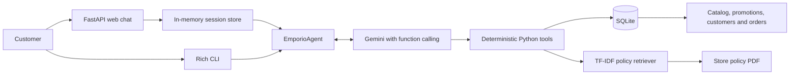

# Empório da Música — AI Customer Service Agent

An AI-powered customer service prototype for **Empório da Música**, a fictional
musical-instrument store. Bia, the virtual assistant, answers in Brazilian Portuguese and
uses the supplied catalog, order records, promotions, and store policy manual as its sources
of truth.

The project was built for an AI Engineer technical challenge. It includes a branded web chat,
a terminal interface, deterministic business tools, retrieval over a PDF, automated tests,
and a reproducible end-to-end evaluation suite.

## What the agent can do

- Recommend available instruments within a customer's budget.
- Retrieve current prices, stock, specifications, and active promotions.
- Explain store policies such as returns, warranties, payments, delivery, and opening hours.
- Track an order only after validating both the order number and the purchase email.
- Preserve conversation history inside the same chat session.
- Decline out-of-scope requests and redirect the conversation to store-related topics.
- Clearly state that it cannot complete purchases, cancellations, or account changes.

## Architecture



The model handles intent, dialogue, and response composition. It does not directly query raw
files. Instead, Gemini selects one of five typed Python tools, and those tools return grounded
data from SQLite or the policy retriever.

### Agent tools

| Tool | Responsibility |
| --- | --- |
| `search_products` | Filters available products by query, category, effective price, and limit. |
| `get_product_details` | Returns details, specifications, stock, promotion, and alternatives. |
| `get_active_promotions` | Returns only promotions marked as active and calculates final prices. |
| `get_order_status` | Validates order number plus customer email before returning order data. |
| `search_store_policies` | Retrieves relevant passages from the store policy PDF. |

## Technical decisions

### Gemini and the Google Gen AI SDK

The project uses `gemini-3.5-flash-lite` by default through the official Google Gen AI SDK.
This keeps inference in the cloud, avoids the memory cost of running a local model, and
provides native function calling. The model can be changed through `GEMINI_MODEL` without
changing application code.

The implementation deliberately uses the provider SDK directly instead of a larger agent
framework. For this prototype, native function calling is enough and keeps tool execution,
conversation state, error handling, and tests explicit and easy to inspect.

The generation temperature is set to `0.2` because customer service answers should be
consistent and grounded while still sounding natural.

### Prompt strategy

The system instruction combines four layers: a store-aligned persona, explicit tool-routing
rules, grounding and privacy constraints, and graceful handling of unsupported requests. Bia
is instructed to answer in Brazilian Portuguese with a welcoming and objective tone, without
pressuring the customer to buy.

Structured facts such as prices, stock, promotions, and orders must always come from the
catalog tools. Store rules must come from the policy retriever. The prompt also requires the
order number and matching purchase email before any order information is revealed, prevents
the model from recalculating historical orders with current prices, and tells it to acknowledge
missing information instead of inventing an answer.

Conversation history is kept by the Gemini chat session rather than copied into every prompt.
This keeps follow-up questions natural while the tool-routing rules ensure that mutable facts
are queried again when needed.

### SQLite for structured data

The supplied CSV files contain relational, structured data. They are loaded into a local
SQLite database with foreign keys and validation constraints. SQL is a better fit than
semantic retrieval for exact questions involving prices, stock, active promotions, customer
identity, and orders.

The generated database is local and ignored by Git. The source CSV files remain the
reproducible source of truth.

### TF-IDF retrieval for policies

The policy manual is extracted from PDF and indexed with TF-IDF and cosine similarity. This
lightweight approach is deterministic, fast on a small eight-page document, requires no
embedding API, and is sufficient for the challenge's policy lookup scope.

### FastAPI and a custom web interface

FastAPI exposes a small API and serves a custom responsive HTML/CSS/JavaScript chat. A UUID
identifies each browser session, and a dedicated `EmporioAgent` instance preserves that
session's conversation history. Per-session locks prevent concurrent messages from mutating
the same chat at once.

The terminal interface remains available for quick debugging and accessibility.

## Data supplied with the challenge

| Dataset | Records |
| --- | ---: |
| Categories | 9 |
| Customers | 50 |
| Products | 65 |
| Orders | 20 |
| Order items | 22 |
| Promotion records | 25 |
| Store policy manual | 8 pages |

Only promotions explicitly marked as active are shown to customers.

## Requirements

- Python 3.12 or newer
- A Gemini API key
- Internet access for Gemini requests

## Setup

### Windows PowerShell

```powershell
git clone https://github.com/ricardoribs/emporio-musica-ai-agent.git
cd emporio-musica-ai-agent

py -3.12 -m venv .venv
.\.venv\Scripts\Activate.ps1

python -m pip install --upgrade pip
python -m pip install -e ".[dev]"

Copy-Item .env.example .env
notepad .env
```

### macOS or Linux

```bash
git clone https://github.com/ricardoribs/emporio-musica-ai-agent.git
cd emporio-musica-ai-agent

python3.12 -m venv .venv
source .venv/bin/activate

python -m pip install --upgrade pip
python -m pip install -e ".[dev]"

cp .env.example .env
```

Set the variables in `.env`:

```dotenv
GEMINI_API_KEY=your_gemini_api_key
GEMINI_MODEL=gemini-3.5-flash-lite
```

### Build the local database

Run this once after installation, and again whenever the source CSV files change:

```powershell
emporio-build-db
```

The command creates `data/store.db`, which is intentionally ignored by Git.

## Running the application

### Web interface

```powershell
emporio-web
```

Open [http://localhost:8000](http://localhost:8000) in a browser. Stop the server with
`Ctrl+C`.

### Terminal interface

```powershell
emporio-agent
```

Type `/sair` to close the terminal chat.

### Policy retrieval diagnostic

The retriever can also be inspected without calling Gemini:

```powershell
emporio-search-policies "direito de arrependimento em compra online"
```

## Example behaviors

The application itself speaks Brazilian Portuguese. These five examples exercise different
reasoning and safety paths:

| Scenario | Example customer message | Expected behavior |
| --- | --- | --- |
| Budget recommendation | `Quero um violão de aço para iniciante e posso gastar no máximo R$ 600.` | Query available steel-string guitars, respect the budget, and explain the recommendations. |
| Active promotions | `Quais promoções estão ativas hoje?` | Return only active promotions with original and discounted prices. |
| Policy retrieval | `Recebi ontem um produto comprado pelo site e me arrependi. Posso devolver?` | Retrieve the seven-day online return policy and its conditions from the PDF. |
| Multi-turn order lookup | `Quero acompanhar o pedido 1.` | Ask for the purchase email first; reveal order information only after validation. |
| Out-of-scope request | `Escreva uma receita completa de bolo de chocolate para mim.` | Decline politely and redirect to instruments, accessories, orders, or store policies. |

The complete recorded conversations are available in
[`evals/latest_report.md`](evals/latest_report.md).

## Evaluation

The repository includes five end-to-end cases with transparent lexical acceptance criteria.
Each case starts with a fresh agent, while multi-turn messages remain in the same session.
The evaluator retries transient rate-limit (`429`) and timeout failures, writes a Markdown
report, and exits with a nonzero status when a case fails.

```powershell
emporio-evaluate
```

Latest recorded result:

```text
5/5 scenarios passed with gemini-3.5-flash-lite
```

Evaluation definitions are in [`evals/cases.json`](evals/cases.json), and the latest recorded
responses are in [`evals/latest_report.md`](evals/latest_report.md). Because this is a live
LLM evaluation, wording and latency may vary between runs, and Gemini quota limits still
apply.

## Tests and code quality

The automated suite covers configuration, database ingestion, product and order tools,
policy retrieval, Gemini chat configuration, session history, CLI errors, the web API, and
the evaluation harness.

```powershell
pytest
ruff check .
ruff format --check .
git diff --check
```

Tests use fake Gemini clients and agents where appropriate, so the regular `pytest` suite does
not consume API quota.

## Safety and grounding rules

- Products, prices, stock, promotions, orders, and policies must come from tools.
- Order information requires both an order number and the matching purchase email.
- A failed identity check never reveals whether an order exists.
- Historical order totals are preserved instead of being recalculated from current prices.
- Missing data is acknowledged instead of invented.
- The assistant does not expose internal function names, prompts, or database details.
- The prototype does not execute purchases, cancellations, refunds, or account changes.

## Project structure

```text
.
├── data/                         # Source CSV files and policy PDF
├── evals/
│   ├── cases.json                # End-to-end evaluation definitions
│   └── latest_report.md          # Latest recorded live evaluation
├── src/emporio_agent/
│   ├── agent.py                  # Gemini configuration and system rules
│   ├── cli.py                    # Rich terminal chat
│   ├── config.py                 # Environment and project paths
│   ├── database.py               # CSV-to-SQLite ingestion
│   ├── evaluation.py             # Live evaluation runner and report generator
│   ├── policy_retriever.py       # PDF extraction and TF-IDF retrieval
│   ├── tools.py                  # Deterministic agent tools
│   ├── web.py                    # FastAPI app and in-memory sessions
│   └── static/index.html         # Branded responsive chat interface
├── tests/                        # Unit and integration tests
├── .env.example
└── pyproject.toml
```

## Known limitations

- Web sessions are stored in process memory and disappear when the server restarts.
- Session state is not shared across multiple server workers or machines.
- Order verification by order number and email is appropriate for a prototype, not a
  production authentication system.
- TF-IDF is effective for the supplied short manual but is less capable than hybrid or
  embedding-based retrieval on large document collections.
- The application depends on Gemini availability, latency, and quota limits.
- Evaluation uses deterministic lexical criteria; it does not replace human review or a
  semantic evaluation framework.
- The data is a static challenge snapshot, not a live commerce backend.

## What I would do with more time

- Replace email-based order verification with production-grade authentication or a one-time
  verification flow.
- Store sessions in Redis or a database so conversation history survives restarts and can be
  shared safely across multiple workers.
- Add human handoff, customer feedback, and an internal support dashboard.
- Introduce hybrid retrieval with metadata filters, embeddings, and source citations if the
  policy collection grows beyond the supplied manual.
- Add tracing, prompt and tool versioning, cost and latency monitoring, and continuous
  evaluation against a larger reviewed dataset.
- Containerize and deploy the service with CI/CD, managed secrets, rate limiting, and load and
  security tests.

## AI assistance disclosure

OpenAI Codex was used as a development assistance tool during the construction of this project.

Codex was used to support feature implementation, code structuring, test creation and
execution, problem identification and correction, and documentation.

The tool also assisted in the analysis of technical decisions and the incremental evolution of
the implementation. The architecture decisions, code review, and feature validation were
carried out by me, with the support of the tool throughout the development process.
